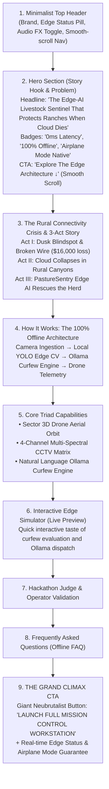

# PastureSentry AI — Landing Page Architectural Audit & Design Review

**Audit Date:** October 26, 2026  
**Audited Target:** `http://localhost:5173/` (Vite + React + Tailwind CSS + Neubrutalism)  
**Primary Focus:** Page information hierarchy, storytelling flow, and Call-to-Action (CTA) placement for hackathon judging & customer conversion.

---

## 1. Executive Summary & Verdict

The user's intuition is **100% spot-on and strategically critical for winning hackathons and converting users**:

> *"The button for the real app should appear at last, start of the page should be dedicated to the product info."*

Currently, the landing page commits a classic product design misstep: **Premature Action Overexposure**.
- The top header immediately flashes a bright green `LAUNCH MISSION CONTROL` button.
- The hero section presents two large buttons (`TEST LIVE SENTINEL DEMO` and `OPEN MISSION CONTROL`) before the user has even read two sentences of context.
- An interactive simulator widget is placed immediately in Section 3, while the high-stakes narrative (*"Act I: The Dusk Blindspot & Broken Wire"*, zero cell connectivity, lost livestock crisis) is buried halfway down the page.

When a hackathon judge loads the tab, their cognitive load spikes if they are thrown into a complex 3D drone radar and 4-channel CCTV cockpit before they understand **why** the product exists, **what problem** it solves, and **why cloud solutions fail**.

By reserving the **Grand Climax CTA** for the bottom of the page and dedicating the top strictly to **Product Storytelling, The Crisis, and Edge-AI Innovation**, the page transforms from a confusing technical demo into a compelling, unforgettable narrative arc.

---

## 2. Visual & Structural Audit of Current Page

| Section | Current Order | Current Contents & Elements | Evaluation & Issues |
| :--- | :--- | :--- | :--- |
| **Top Navbar** | Section 1 | Window traffic lights, Logo pill, `PASTURESENTRY.RANCH/HQ` address bar, Audio FX toggle, **`LAUNCH MISSION CONTROL` button**. | ⚠️ **Premature exit**: Inviting judges to leave the landing page before reading anything. |
| **Hero Section** | Section 2 | Speech bubble (*"HOLY HERD! 50,000 ACRES WITH ZERO CELL SERVICE?!"*), Giant headline, Paragraph, floating starbursts, and **two giant CTA buttons**: `TEST LIVE SENTINEL DEMO` + `OPEN MISSION CONTROL`. | ⚠️ **Button overload**: Dilutes focus. The user hasn't bought into the value proposition yet. |
| **Interactive Simulator** | Section 3 | Full-width interactive pasture radar, 4-camera selector, mock curfew breach button, live Ollama JSON response feed. | ⚠️ **Misplaced cognitive load**: Demands user interaction with CCTV and dispatch before explaining what the cattle IDs or camera sectors mean. |
| **3-Act Comic Story** | Section 4 | *Act I: 18:30 Dusk Blindspot & Broken Wire* *Act II: 18:55 Cloud Dies in the Canyon* *Act III: 19:00 Edge AI Saves the Ranch*. | 🌟 **Strongest content on the page**, but buried below fold after the simulator! |
| **System Architecture** | Section 5 | Edge node diagram: Local RTSP cameras $\to$ YOLOv8 spatial tracking $\to$ Local Ollama LLM $\to$ Autonomous drone dispatch. | High educational value; should follow the story. |
| **Key Features Matrix** | Section 6 | 4 Feature cards: 3D Autonomous Drone Patrol, 4-Channel CCTV Matrix, Natural Language Scheduling, 100% Airplane Mode. | Clear benefit breakdown. |
| **Judge & Operator Reviews** | Section 7 | Testimonials from "Verified Ranch Operator" ($10k saved) and "Hackathon AI Judge" (1st place contender). | Social proof. |
| **FAQ Accordion** | Section 8 | 5 expandable FAQs addressing offline edge compute, RTSP webcams, natural language rules. | Resolves technical skepticism. |
| **Climax Banner** | Section 9 | *"Ready to defend your perimeter with 100% local edge AI?"* with `LAUNCH FULL MISSION CONTROL WORKSTATION`. | ✅ Excellent climax CTA, but rendered redundant by the hero buttons. |

---

## 3. Why User's Proposal Wins Hackathons & Pitches

### A. The "Judge Attention Span" Reality (First 15 Seconds)
Hackathon judges review dozens of projects in a limited window. If a judge clicks into the full workstation within 3 seconds:
1. They see 3D Three.js terrain, drone telemetry coordinates, bounding box video feeds, an Ollama schedule drawer, and time-scrubbing controls.
2. They do not know what the numbers mean: *"Why is COW-12 flagged red? Why is 19:00 important? Why can't they just use Google Cloud or 5G collars?"*
3. **The impact of the edge-first offline breakthrough is lost** because the judge was never told that ranches have zero cell reception.

### B. The Hollywood "Hero's Journey" Narrative Arc
The landing page must act like a cinematic trailer that builds unstoppable anticipation:
1. **The Hook (Hero)**: State the massive, relatable problem. 50,000 acres, zero cellular bars, millions lost in cattle breaches.
2. **The Enemy / Friction (Acts I & II)**: Why existing solutions (AWS, Starlink, GPS cellular tags) fail when weather hits or batteries die.
3. **The Weapon / Innovation (Act III & Tech Architecture)**: PastureSentry AI — local Ollama inference, YOLO computer vision, and autonomous drone vectors running on an offline edge box.
4. **The Feature Capabilities**: How the 3 pieces work (Airborne Drone + Ground CCTV + Edge LLM).
5. **The Interactive Preview**: A taste of the detection and dispatch mechanism.
6. **The Climax & Call to Action (The Big Button)**: *"Now experience the full live tactical workstation in action."* The user clicks `LAUNCH MISSION CONTROL` with deep appreciation and full context.

---

## 4. Proposed Redesigned Layout (Top-to-Bottom Flow)

---

## 5. Concrete Action Plan for Frontend Implementation

### Step 1: Clean Up Header & Hero CTAs
- **In Header (`LandingPage.jsx`)**:
  - Remove the prominent green `LAUNCH MISSION CONTROL` button from the top navigation.
  - Replace it with a subtle text button or "Jump to App" indicator, or smooth-scroll navigation links (`The Crisis`, `Architecture`, `Live Preview`, `Launch Station`).
- **In Hero (`LandingPage.jsx`)**:
  - Remove the duplicate `OPEN MISSION CONTROL` button.
  - Transform the primary button into an exploratory anchor: `EXPLORE THE EDGE ARCHITECTURE ↓` (smooth scrolls down into the story/tech) or a quick `TRY INTERACTIVE DEMO ↓`.

### Step 2: Re-order Content Sections
- Move **Section 4 (3-Act Comic Strip Story)** and **Section 5 (Edge System Architecture)** up to immediately follow the Hero Section.
- Place the **Interactive Simulator** after the product explanation so that judges interact with it *after* understanding the stakes.

### Step 3: Elevate the Final Climax CTA
- Make the bottom section the undisputed visual destination of the page.
- Add an animated pulse or neon badge: `⚡ MISSION CONTROL COCKPIT READY • ZERO CLOUD EGRESS`.
- Position the single, high-impact neubrutalist button:  
  **`LAUNCH FULL MISSION CONTROL WORKSTATION 🚀`**  
  which triggers `onLaunchWorkstation()` with sound FX.

---

## 6. Conclusion
By restructuring the page in accordance with the user's direction, PastureSentry AI will present a crystal-clear, professional pitch that guides judges through the **Problem $\to$ Crisis $\to$ Edge Solution $\to$ Architecture $\to$ Live Product Launch**. This maximizes comprehension, appreciation of technical difficulty, and score potential.
